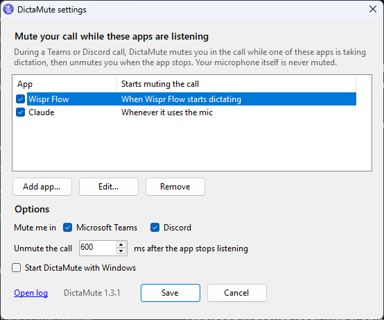
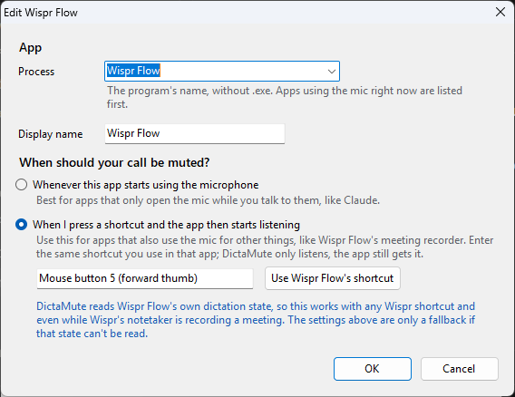
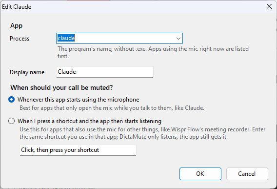
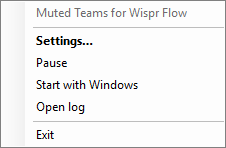

# DictaMute

Mute **only Microsoft Teams** while you talk to your dictation app — [Wispr Flow](https://wisprflow.ai),
Claude's voice input, or anything else — so people in your call don't hear your dictation.
Your microphone itself is never muted, so the dictation app keeps hearing you.

A tiny Windows tray app: one ~30 KB exe, no installer, no dependencies. There's also an
[experimental macOS build](#macos-experimental-untested).



## How it works

1. You start dictating in your app as usual.
2. As soon as that app's microphone stream becomes active, DictaMute presses Teams' own
   **mic button** in your meeting (via Windows UI Automation — no fake keystrokes, so it never
   interrupts your dictation app).
3. When the app stops listening, DictaMute presses the button again to unmute you.

It leaves Teams alone when you're not in a call, you're already muted, you unmute yourself
mid-dictation, or DictaMute is paused.

### Two ways an app can start muting Teams

| Mode | Use it for | Example |
|------|-----------|---------|
| **Whenever this app starts using the microphone** | Apps that only open the mic while you're talking to them | Claude's voice input |
| **When I press a shortcut and the app then starts listening** | Apps that also keep the mic open for other things | Wispr Flow (its meeting recorder holds the mic during calls) |

In shortcut mode, enter the **same shortcut you use in that app** — a key combo like `Ctrl+Win`
or a middle/thumb mouse button. DictaMute only *listens* for it; the app still receives it.
For Wispr Flow, **Use Wispr Flow's shortcut** reads it straight from Wispr's settings.

| Shortcut mode (Wispr Flow) | Microphone mode (Claude) |
|---|---|
|  |  |

## Download and run

1. Download **`DictaMute.exe`** from the [latest release](https://github.com/farhanulju/dictamute/releases/latest).
2. Put it somewhere permanent (e.g. `Documents\DictaMute\`) and double-click it.
3. Windows SmartScreen may say *"Windows protected your PC"* because the exe isn't code-signed.
   Click **More info → Run anyway**. (Prefer not to? Build it yourself — see below.)
4. The settings window opens on first run. Check the apps you use, adjust their shortcuts, tick
   **Start DictaMute with Windows**, and click **Save**.

### The tray icon



The microphone icon in the system tray shows the state at a glance:

- **grey** — not in a call (or paused)
- **blue** — in a call, watching your dictation apps
- **red with a slash** — muting Teams right now

Double-click it for settings. Right-click for **Pause**, **Start with Windows**, **Open log**,
and **Exit**.

<br clear="right">

## Adding another dictation app

**Settings → Add app…**, pick the app from the list (apps using the mic right now are listed
first), and choose a mode. Not sure which mode? Open the app without dictating and check
whether it shows up at the top of the list. If it does, it keeps the mic open — use shortcut mode.

## Requirements

- Windows 10/11, 64-bit
- The **new** Microsoft Teams, in **English** (DictaMute reads the "Mute mic" / "Unmute mic" button label)

## Privacy

DictaMute runs entirely on your PC and never connects to the internet. To recognise your
shortcuts it watches key and mouse-button presses system-wide, but it only compares them with
your shortcuts — keystrokes are never stored, logged, or sent anywhere. The log
(`%LOCALAPPDATA%\DictaMute\log.txt`) records app states and the title of the focused window
when a shortcut fires, which can include meeting names.

## Known limitations

- **The very first moment of dictation can still reach the call.** Teams is muted once the app
  has started listening (typically 0.1–0.5 s), not before — muting earlier interferes with the
  dictation app's startup.
- **Focus briefly flickers to Teams.** Pressing Teams' button moves focus to the meeting
  window; DictaMute restores your previous window within ~80 ms.
- **An app that's already holding the mic can't be detected starting dictation.** If Wispr
  Flow's mic is already open when you press the shortcut, DictaMute leaves Teams alone (and
  says so in the log).
- Relies on Teams' internal button id (`microphone-button`) and English labels; a Teams update
  or another UI language may need a code change.

## macOS (experimental, untested)

> **This build has never been run on a real Mac.** It compiles on GitHub's macOS runners and
> mirrors the Windows logic, but nobody has tried it with Teams yet. If you do, please
> [open an issue](https://github.com/farhanulju/dictamute/issues) with what happened and the
> lines from `~/Library/Logs/DictaMute.log`.

**Requirements:** macOS 14 Sonoma or later (Apple Silicon or Intel), the new Microsoft Teams in English.

**Install**

1. Download `DictaMute-mac.zip` from the [releases](https://github.com/farhanulju/dictamute/releases)
   (look for a `-mac-beta` pre-release), unzip it, and move **DictaMute.app** to **Applications**.
2. The app isn't notarized by Apple, so macOS blocks the first launch. Right-click it → **Open** →
   **Open**, or run `xattr -dr com.apple.quarantine /Applications/DictaMute.app` once in Terminal.
3. Grant the two permissions it asks for in **System Settings → Privacy & Security**:
   - **Accessibility** — to read and press Teams' mic button.
   - **Input Monitoring** — only needed for apps in shortcut mode, to notice the shortcut.
4. A microphone appears in the menu bar. **Settings…** lists your dictation apps; **Launch at Login**
   works once the app is in Applications.

**Differences from Windows**

- The default Wispr Flow shortcut is **Fn** (Wispr's Mac default). Shortcuts are typed rather than
  recorded, e.g. `Fn`, `Ctrl+Option+Space`, `Mouse5`. Modifiers: `Ctrl`, `Shift`, `Option`, `Cmd`, `Fn`.
- Apps are named as they appear in the Applications folder (`Wispr Flow`, `Claude`). Helper processes
  (`Claude Helper` etc.) count as their app.
- Menu-bar icon: outline mic = not in a call, filled mic = in a call, red slashed mic = muting Teams.

**Not yet verified**

- That DictaMute finds Teams' mic button through macOS accessibility (it looks for the web id
  `microphone-button` or a "Mute mic" / "Unmute mic" label, and logs what it found). If it can't, it
  tries again after setting `AXEnhancedUserInterface` on Teams, which can make some window managers
  animate oddly until Teams restarts.
- That Core Audio reports Teams, Wispr Flow and Claude as "running input" exactly while they listen.
- That pressing the button doesn't steal focus (it restores the previous app if it does).

**Build it yourself** (on a Mac with Xcode 15+): `bash mac/scripts/bundle.sh` → `mac/dist/DictaMute.app`.

## Build from source

No SDK needed — it uses the C# compiler that ships with Windows.

```bat
git clone https://github.com/farhanulju/dictamute.git
cd dictamute
install.cmd
```

`install.cmd` builds the app, copies it to `%LOCALAPPDATA%\DictaMute`, turns on Start with
Windows, and starts it. `uninstall.cmd` undoes all of that. `build.cmd` only builds (into `bin\`).
`bin\DictaMute.exe --screenshots docs\screenshots` regenerates the images in this README.

## Troubleshooting

- Tray icon → **Open log** shows every step (`Wispr Flow: shortcut, armed`,
  `Claude: started listening`, `muted Teams`, `unmuted Teams`, focus restores).
- `CaptureProbe.exe 30` (built with the source) prints which apps have an active microphone
  stream for 30 seconds — handy for choosing a mode for a new app.

## Files

| File | What it is |
|------|-----------|
| `src/DictaMute.cs` | Tray app, keyboard/mouse hooks, per-app state machine, Teams UI Automation, focus restore |
| `src/Settings.cs` | Settings model (JSON), shortcut parsing, reading Wispr Flow's shortcut |
| `src/SettingsForm.cs` | Settings window, app editor, shortcut recorder |
| `src/Icons.cs` | Tray and app icons, drawn in code at each size |
| `src/MakeIcon.cs` | Build-time helper that writes the exe's multi-size `.ico` |
| `src/AudioCapture.cs` | Core Audio interop: which processes have an active mic stream |
| `src/CaptureProbe.cs` | Small console diagnostic built on `AudioCapture.cs` |
| `build.cmd` / `install.cmd` / `uninstall.cmd` | Build, install + autostart, remove |
| `mac/` | Experimental macOS menu-bar app (Swift); `mac/scripts/bundle.sh` builds it, `.github/workflows/mac.yml` runs that on every change |

## License

MIT
